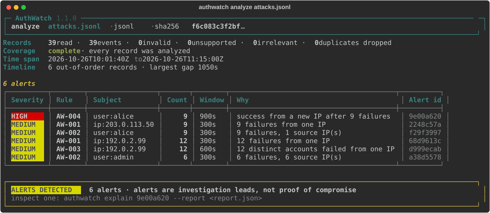
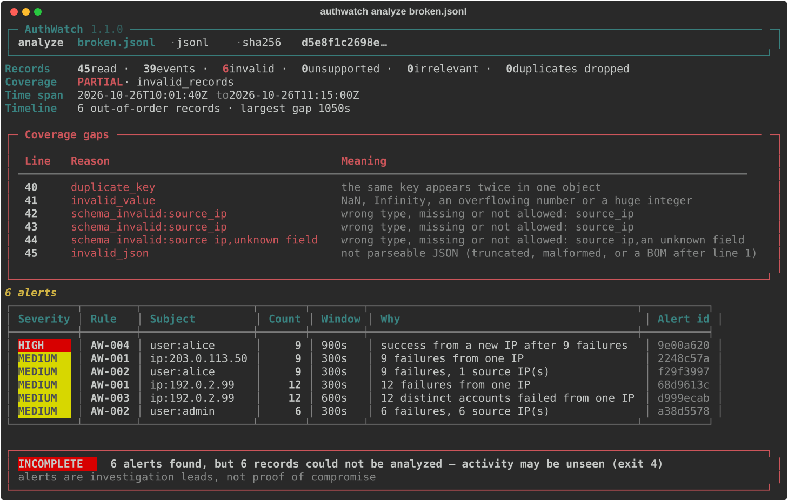
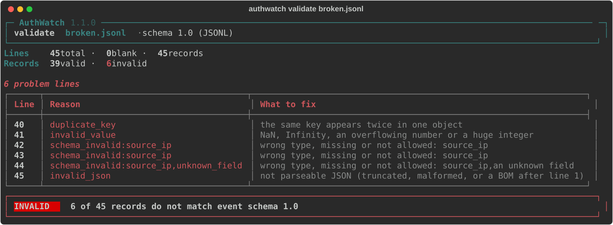
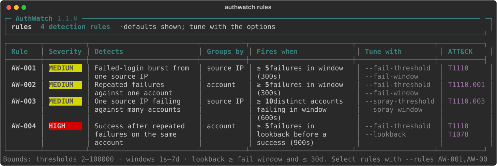
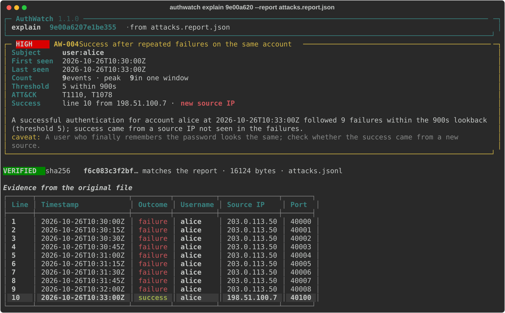
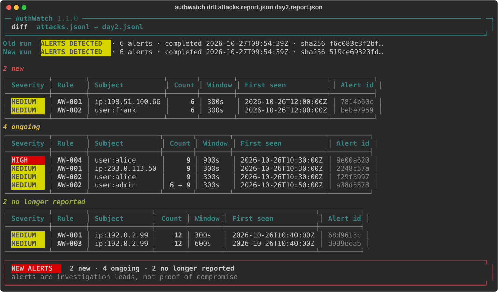

# AuthWatch User Guide

This guide covers getting your data ready, running AuthWatch, reading what it tells you, and acting on it. A final section explains how a reviewer can check the tool's claims for themselves.

AuthWatch version: **1.1.0** · Event schema: **1.0**

---

## Contents

1. [What AuthWatch is (and is not)](#1-what-authwatch-is-and-is-not)
2. [Install and check](#2-install-and-check)
3. [A five-minute walkthrough](#3-a-five-minute-walkthrough)
4. [Preparing your input](#4-preparing-your-input)
5. [Running an analysis](#5-running-an-analysis)
6. [Reading the result: the triage order](#6-reading-the-result-the-triage-order)
7. [Investigating each alert type](#7-investigating-each-alert-type)
8. [When coverage is partial](#8-when-coverage-is-partial)
9. [Explaining and verifying an alert](#9-explaining-and-verifying-an-alert)
10. [Tuning thresholds and windows](#10-tuning-thresholds-and-windows)
11. [Privacy and handling reports safely](#11-privacy-and-handling-reports-safely)
12. [Using AuthWatch in scripts and automation](#12-using-authwatch-in-scripts-and-automation)
13. [Normalizing and exporting](#13-normalizing-and-exporting)
14. [Troubleshooting](#14-troubleshooting)
15. [For reviewers: checking the tool's claims](#15-for-reviewers-checking-the-tools-claims)
16. [Limits you should know about](#16-limits-you-should-know-about)
17. [Quick reference](#17-quick-reference)

---

## 1. What AuthWatch is (and is not)

AuthWatch reads a file of authentication records and looks for four patterns:

| Rule | Pattern | Typical cause worth checking |
|---|---|---|
| **AW-001** | Many failures from one source IP in a short window | Password guessing from one machine |
| **AW-002** | Many failures against one account in a short window | Guessing one account, possibly from many machines |
| **AW-003** | One source IP failing against many different accounts | Password spraying |
| **AW-004** | A successful login after repeated failures on the same account | A guess that may have worked |

Every run tells you two separate things:

- **Did any rule fire?** This is the `result`.
- **Could AuthWatch see all of your input?** This is the `coverage`.

AuthWatch never presents a partial look as a clean bill of health. If it could not read or use some records, it says so and exits with code `4`, even when it found nothing.

**What it does not do:**

- It does not block, disable or change anything.
- It does not prove an attack happened. An alert is a lead for a person to investigate.
- It does not identify people. An IP address can be shared by many users through NAT, VPNs or proxies.
- It cannot tell whether log lines were deleted before you collected the file.

---

## 2. Install and check

AuthWatch needs Python 3.11 or newer.

```bash
git clone https://github.com/PranavY-01/AuthWatch.git
cd AuthWatch
python -m venv .venv
. .venv/bin/activate            # Windows PowerShell: .venv\Scripts\Activate.ps1
python -m pip install -e ".[dev]"
authwatch --version             # prints: authwatch 1.1.0
```

If the `authwatch` command is not found, use `python -m authwatch` instead; it behaves identically. Every example in this guide works either way.

Run `authwatch` with no command to see an overview of every command, with examples and the exit codes. `authwatch COMMAND --help` lists the options of one command.

**Windows users:** run this once per PowerShell session. It keeps non-ASCII characters intact when output is piped or saved.

```powershell
$env:PYTHONUTF8 = "1"
```

---

## 3. A five-minute walkthrough

The repository includes three synthetic sample files. They use only documentation IP ranges, so they contain no real data.

```bash
python samples/make_samples.py                 # (re)creates samples/*.jsonl
authwatch analyze samples/clean.jsonl          # exit 0: nothing found, everything analyzed
authwatch analyze samples/attacks.jsonl        # exit 1: six alerts
authwatch analyze samples/broken.jsonl         # exit 4: six alerts, but six records unreadable
```

The output of the second run:



To read this output:

1. **Header.** The file name, its format, and the start of its SHA-256 fingerprint.
2. **Records.** How every line was accounted for. Invalid or unsupported counts turn red when they are not zero.
3. **Coverage.** `complete` means every record was usable. Read this line before anything else.
4. **Timeline.** Signals about ordering and silent gaps (see [§8.3](#83-timeline-signals)).
5. **Alert table.** Most severe first, then oldest first. The last column is each alert's id, which you pass to `authwatch explain` ([§9](#9-explaining-and-verifying-an-alert)).
6. **Result banner.** The overall verdict, which matches the exit code.

Now try `broken.jsonl`. It contains the same attacks plus six damaged lines. A red **Coverage gaps** panel lists each one with its line number, reason code and what it means:



The alerts are still real. The difference is that the absence of *other* alerts no longer means anything, because six records went unexamined.

---

## 4. Preparing your input

AuthWatch accepts two input formats.

| Format | Flag | Use it when |
|---|---|---|
| **JSONL** (default) | `--input-format jsonl` | You can export or convert your records to AuthWatch's event schema. This is the dependable path |
| **OpenSSH text** | `--input-format openssh` | You have raw sshd lines from `/var/log/auth.log`, `/var/log/secure` or `journalctl`. **Experimental**: tested only against authored sample lines |

### 4.1 The JSONL event format

Put one JSON object on each line, encoded in UTF-8. This is a minimal record:

```json
{"schema_version":"1.0","event_type":"authentication","timestamp":"2026-10-26T10:30:00Z","outcome":"failure","username":"alice","source_ip":"203.0.113.50","source_os":"linux","source_product":"my-export"}
```

**Required in every record:**

| Field | Value |
|---|---|
| `schema_version` | exactly `"1.0"` |
| `event_type` | exactly `"authentication"` |
| `timestamp` | an RFC 3339 time **with** a timezone, e.g. `2026-10-26T10:30:00Z` or `2026-10-26T16:00:00+05:30`; or `null` if unknown |
| `outcome` | `"success"`, `"failure"` or `"unknown"` (lower case) |
| `username` | the account name as the source wrote it, or `null` |
| `source_ip` | an IPv4 or IPv6 address as a **string**, or `null` |
| `source_os` | a short lower-case label, e.g. `linux`, `windows` |
| `source_product` | a short lower-case label for the log source, e.g. `openssh`, `vpn-gateway` |

`timestamp`, `username` and `source_ip` may be `null`, but the key must be present. A missing key is an error. This catches typos such as `sourceip`, which would otherwise silently lose the IP.

**Optional fields:**

| Field | Notes |
|---|---|
| `source_port` | an integer from 0 to 65535 |
| `source_host` | the machine that wrote the record |
| `record_id` | a unique id for the record within its host and product; used to drop duplicates |
| `event_id` | the original event code, e.g. Windows `4625` |
| `failure_reason` | one of `bad_credential`, `unknown_account`, `locked`, `disabled`, `expired`, `other`; only valid with `outcome: "failure"` |
| `auth_method` | e.g. `password`, `publickey` |
| `logon_type` | an integer from 0 to 255 |
| `parser_name` | the name of the tool that produced the record |
| `parse_warnings` | a list of short strings |

Any other field makes the record invalid.

### 4.2 Common mistakes when producing JSONL

`authwatch validate` ([§4.4](#44-checking-a-file-before-analysis-validate)) finds all of these in one pass.

| Mistake | What AuthWatch reports |
|---|---|
| A timestamp without a timezone (`2026-10-26T10:30:00`) | `invalid_timestamp` |
| A space instead of `T`, or a lower-case `t`/`z` | `invalid_timestamp` |
| A port written as `"22"` or `22.0` | `schema_invalid:source_port` |
| An IP written as a number (`3232235801`) | `schema_invalid:source_ip` |
| `"FAILURE"` or `"failed"` as the outcome | `schema_invalid:outcome` |
| The same key twice in one object | `duplicate_key` |
| A misspelled or extra field | `schema_invalid:...,unknown_field` |
| Saving the file as UTF-16 (PowerShell 5.1 `>` or `Out-File` default) | the whole run stops with exit 3 |

**Two rules about `outcome: "unknown"` and duplicates:**

- **Only emit `"unknown"` when the outcome is truly unknown.** Such records might be failures, so AuthWatch counts them as unusable, and the run becomes `incomplete`. If a record is not an authentication attempt at all, leave it out.
- **Duplicates are dropped by `record_id` only.** Two identical records *without* a `record_id` both count, because two failures in the same second are exactly what brute force looks like. If your export can repeat lines, give each record a stable `record_id`.

### 4.3 A small conversion example

Suppose your system exports CSV with the columns `time,user,ip,result`, and `time` is already in UTC. This Python script writes valid JSONL:

```python
import csv, json, sys

with open(sys.argv[1], newline="", encoding="utf-8") as src, \
     open(sys.argv[2], "w", encoding="utf-8", newline="\n") as dst:
    for row in csv.DictReader(src):
        dst.write(json.dumps({
            "schema_version": "1.0",
            "event_type": "authentication",
            "timestamp": row["time"].replace(" ", "T") + "Z",   # only if the source is UTC
            "outcome": "success" if row["result"] == "OK" else "failure",
            "username": row["user"] or None,
            "source_ip": row["ip"] or None,
            "source_os": "linux",
            "source_product": "my-csv-export",
        }) + "\n")
```

Never invent a timezone. If you do not know which timezone the source used, AuthWatch cannot correctly tell which events fall within the same window.

### 4.4 Checking a file before analysis: `validate`

If you are writing a converter, check its output with `validate` before running `analyze`:

```bash
authwatch validate events.jsonl
```



`validate` checks the format only; it runs no detection. It reports:

- **Every problem line,** with its reason code and what to fix. Text mode shows the first 50; use `--max-errors N` for more, or `--format json` to get all of them (up to 1 000).
- **Valid records that will limit analysis:** `outcome: "unknown"`, a `null` timestamp, username or source IP, and a `record_id` repeated with different content. These records pass validation, but `analyze` reports them as coverage gaps.
- **Normalization warnings,** such as `ip_canonicalized` (for example `::ffff:1.2.3.4` written for `1.2.3.4`) and `username_has_format_or_control_chars`.

It exits `0` when every non-blank line is a valid schema-1.0 event and there is at least one. It exits `4` when any line is invalid or the file has no records, `3` for UTF-16 or binary input, and `2` for a bad path or option.

### 4.5 OpenSSH logs (experimental)

```bash
authwatch analyze auth.log --input-format openssh --assume-year 2026 --assume-tz +05:30
```

- **Classic syslog lines** (`Oct 26 10:30:00 host sshd[1234]: ...`) carry no year and no timezone. You must state both with `--assume-year` and `--assume-tz`; AuthWatch refuses to guess.
  - `--assume-tz` accepts `Z`, `UTC` or a fixed offset such as `+05:30`. Zone names like `Europe/London` are not accepted.
  - When the file passes from December to January, the year is increased automatically.
- **Lines that start with an RFC 3339 timestamp** carry their own timezone and need neither option.

**How lines are classified:**

| Line | Treated as |
|---|---|
| `Failed password for ... from <ip> port <n> ssh2` and `Accepted ... for ...` | events |
| `Invalid user ...`, `Connection closed by ...`, `Disconnected from ...`, `pam_unix(sshd:...)` and other listed bookkeeping | irrelevant (ignored safely) |
| Lines from other programs (`cron`, `systemd`, ...) | irrelevant |
| Any other sshd message | **unsupported**: the run becomes `incomplete` |
| `message repeated N times` | **unsupported**: these lines hide N events. Turn off repeat reduction in rsyslog (`$RepeatedMsgReduction off`) and collect again |

The OpenSSH adapter has been tested only against authored sample lines. Before relying on it, run it on a sanitized sample of your own logs and check that the `Records` line matches what you expect.

---

## 5. Running an analysis

```bash
authwatch analyze INPUT [options]
```

| Option | Default | Purpose |
|---|---|---|
| `--report PATH` | — | Save the full JSON report. **Use this whenever the result matters.** |
| `--format text\|json` | `text` | `json` prints the report itself on stdout and nothing else |
| `--csv PATH` | — | Save a one-row-per-alert table for spreadsheets |
| `--rules AW-001,AW-004` | all four | Run only some rules; the selection is recorded in the report |
| `--fail-threshold N` | `5` | Failures needed for AW-001, AW-002 and AW-004 |
| `--fail-window DUR` | `300s` | Window for AW-001 and AW-002 |
| `--spray-threshold N` | `10` | Distinct accounts needed for AW-003 |
| `--spray-window DUR` | `600s` | Window for AW-003 |
| `--lookback DUR` | `900s` | How far back AW-004 looks for failures before a success |
| `--redact-usernames` | off | Replace usernames with tokens in every output (see [§11](#11-privacy-and-handling-reports-safely)) |
| `--force-report` | off | Allow overwriting an existing file that is not an AuthWatch report |
| `--input-format`, `--assume-year`, `--assume-tz` | `jsonl` | See [§4.5](#45-openssh-logs-experimental) |

Durations are a whole number followed by `s`, `m`, `h` or `d`, e.g. `90s`, `5m`, `1h`, `2d`.

The allowed ranges are:

- thresholds: 2 to 100 000;
- windows: 1 second to 7 days;
- `--lookback`: at least `--fail-window` and at most 30 days.

AuthWatch rejects anything outside these ranges with exit `2` before reading the input.

**Safe output paths.** AuthWatch refuses to write a report or CSV over:

- the input file itself, or a hard link to it;
- a directory or a symlink;
- a file that is not an earlier AuthWatch report (unless you pass `--force-report`).

Writes are atomic, so an interrupted run never leaves a half-written report.

---

## 6. Reading the result: the triage order

Always read the result in this order.

### Step 1: the exit code

| Exit | Meaning | What to do |
|---|---|---|
| `0` | Everything analyzed; no rule fired | Record the result; see the caveat below |
| `1` | Everything analyzed; alerts found | Investigate the alerts ([§7](#7-investigating-each-alert-type)) |
| `2` | Bad option, unsafe output path, or missing input | Fix the command ([§14](#14-troubleshooting)); nothing was analyzed |
| `3` | The input file as a whole is unusable (UTF-16 or binary) | Re-save the file as UTF-8 |
| `4` | Analysis **incomplete**, or an operational failure | Read the coverage section ([§8](#8-when-coverage-is-partial)) |
| `130` | Interrupted with Ctrl+C | Run again |

Exit `0` means "nothing matched the rules in data that was fully analyzed". It does not mean the system is secure (see [§16](#16-limits-you-should-know-about)).

### Step 2: coverage, before findings

In the terminal, read the `Coverage` line. In the report, read `coverage.complete` and `coverage.reasons`.

- `complete`: both the alerts **and** the absence of alerts can be trusted, within the rules' limits.
- `PARTIAL`: alerts can be trusted, but the absence of alerts cannot. Some records were not examined.

### Step 3: the alerts

Alerts are sorted with HIGH severity first, then by time. The terminal shows the first 20; the report holds all of them.

### Step 4: the timeline

The timeline shows the time span covered, the longest silent gap, and how many records were out of order. Use it to check that the file covers the period you think it does.

### `status` versus `result` in the report

| `status` | `result` | Meaning |
|---|---|---|
| `clean` | `clean` | Complete, nothing found |
| `alerts_detected` | `alerts_detected` | Complete, alerts found |
| `incomplete` | `clean` | Nothing found **in what could be analyzed**. This is not a clean result |
| `incomplete` | `alerts_detected` | Alerts found, and other activity may be unseen |

---

## 7. Investigating each alert type

Each alert in the report has `first_seen`, `last_seen`, `count`, `peak_in_window`, `threshold`, `window_seconds`, a plain-language `description`, `caveats`, and `evidence` (line numbers, top usernames, top source IPs).

`authwatch rules` lists every rule with its defaults, the options that tune it and its MITRE ATT&CK tags (add `--format json` for a machine-readable list):



### AW-004 — Success after repeated failures (HIGH)

*A login succeeded after at least `threshold` failures on the same account within the lookback.*

1. Check `evidence.ip_changed`.
   - **`true`:** the success came from an address that never failed. This is the pattern most worth escalating.
   - **`false`:** the same source failed and then succeeded. This can be a user who finally remembered the password.
2. Contact the account owner and ask whether they logged in at `last_seen` from `evidence.success_ip`.
3. Look at what the account did after the success: sessions, commands, data access.
4. If the account owner does not recognise the login, treat it as a possible compromise: reset the credentials and review the account's activity.

Each run of failures produces only one AW-004 alert, because AuthWatch consumes those failures once they trigger an alert. A second success right afterwards needs fresh failures to fire again.

### AW-001 — Failure burst from one IP (MEDIUM)

1. Identify the address: internal or external, a known scanner, a NAT gateway or a VPN exit.
2. Look at `evidence.usernames`. One account suggests guessing; many accounts suggest spraying (check for a matching AW-003 alert).
3. Check for any success from the same address around the same time.

**Common false positives:** a shared NAT or proxy address, a monitoring probe with a bad password, a misconfigured script.

### AW-002 — Repeated failures on one account (MEDIUM)

1. Use the "N source IP(s)" count. One source is often a user or a service with a stale password. Many sources means a distributed attack on one account.
2. Check whether the account is a service account with a recently changed password.
3. Check whether the account was locked out.

**Common false positives:** a phone or mail client retrying an old saved password, a scheduled job with expired credentials.

### AW-003 — One IP failing against many accounts (MEDIUM)

`peak_in_window` here is the number of distinct accounts tried within one window.

1. Many unrelated account names, especially names that do not exist, strongly suggest spraying or enumeration.
2. Check for any success from that IP. An AW-004 alert on any of those accounts is urgent.

An AW-001 alert on the same address is expected: a spray is also a burst of failures by volume. Overlapping alerts for one burst are normal, not double counting.

### Reading the counts

- **`count`** is the number of events in the whole episode.
- **`peak_in_window`** is the highest value the rule saw within a single window.

A long attack is reported as **one** alert (an "episode") rather than one alert per failure. A 500-failure flood is one alert with `count: 500`.

---

## 8. When coverage is partial

Each reason in `coverage.reasons` tells you what went unseen and what to do about it.

| Reason | Meaning | What to do |
|---|---|---|
| `no_events` | Nothing usable was found: an empty file, the wrong format, or (OpenSSH) no sshd lines | Check that you passed the right file and `--input-format` |
| `invalid_records` | Some lines could not be read or failed validation | Look at `errors[]` (line number and reason), fix the producer, run again |
| `unsupported_records` | The OpenSSH adapter met lines it does not understand | See the reason per line below; extend collection or convert to JSONL |
| `duplicate_conflicts` | The same `record_id` appeared with different content | Your export is inconsistent; check those lines (`DUPLICATE_CONFLICT` entries) |
| `uncorrelatable:<RULE>` | Some relevant events lacked something that rule needs | Read `coverage.rules.<RULE>.by_reason` (table below) |
| `alert_cap_reached:<RULE>` | More than 10 000 episodes for one rule; further ones were counted, not stored | Usually a flood or overly low thresholds. Investigate the stored alerts, then consider raising thresholds |

### 8.1 Why events are "uncorrelatable"

`by_reason` names the missing piece:

| Key | Missing piece | Affects |
|---|---|---|
| `unknown_outcome` | The outcome was `unknown` | All rules |
| `missing_timestamp` | `timestamp` was `null` | All rules |
| `missing_source_ip` | `source_ip` was `null` (or an unparseable address in OpenSSH input) | AW-001, AW-003 |
| `missing_username` | `username` was `null` or empty after normalization | AW-002, AW-003, AW-004 |

The same event can be usable by one rule and not by another. A failure without an IP still counts for AW-002 (per account), but AW-001 (per IP) cannot use it.

### 8.2 Per-line reason codes in `errors[]`

| Code | Cause |
|---|---|
| `line_too_long` | The line is longer than 64 KiB |
| `nul_byte` | The line contains a NUL byte |
| `invalid_utf8` | The bytes are not valid UTF-8 |
| `invalid_json` | Not parseable JSON (truncated, malformed, a BOM on a line other than the first) |
| `duplicate_key` | The same JSON key appears twice in one object |
| `invalid_value` | `NaN`, `Infinity`, an overflowing number, or a huge integer |
| `nesting_too_deep` | Absurdly nested JSON |
| `not_an_object` | The line is a JSON array or a bare value |
| `invalid_timestamp` | The timestamp is present but not in the accepted format (or, for OpenSSH, an impossible date) |
| `schema_invalid:<fields>` | The named fields are wrong, missing, or (`unknown_field`) unexpected |
| `unsupported_line_shape` | (OpenSSH) not a syslog or RFC 3339 log line |
| `unsupported_sshd_message` | (OpenSSH) an sshd message AuthWatch does not interpret |
| `repeat_summary` | (OpenSSH) a "message repeated N times" line |

Error entries never repeat the offending value, only its line number. Open the file at that line to see it ([§9](#checking-by-hand)), or run `authwatch validate` on the file ([§4.4](#44-checking-a-file-before-analysis-validate)). The report keeps the first 1 000 errors; `errors_truncated: true` means there were more, and `summary.errors` gives the total.

### 8.3 Timeline signals

`coverage.timeline` reports the following. None of these make coverage partial; they are clues for you.

| Field | What to look for |
|---|---|
| `earliest`, `latest` | Does the file cover the period you meant to examine? |
| `largest_gap_seconds`, `gap_start`, `gap_end` | A long silence on a normally busy server can mean missing or deleted logs |
| `out_of_order_records` | Merged files produce some. Many in a single-source log can mean clock problems or tampering |

AuthWatch sorts events by time before analysis, so out-of-order input does not change the alerts.

---

## 9. Explaining and verifying an alert

Every report records the SHA-256 fingerprint of the exact bytes analyzed (`input.sha256`), and every alert lists the input line numbers that support it (`evidence.lines`). `explain` uses both: it re-hashes the original file, refuses to continue if the hash differs, and then shows the alert next to the exact lines that caused it.

```bash
authwatch analyze attacks.jsonl --report attacks.report.json
authwatch explain 9e00a620 --report attacks.report.json
```



- **Alert id.** Copy it from the last column of the alert table or from `details.alert_id` in the report. The first 4 or more characters are enough, as long as they match only one alert.
- **Finding the file.** By default `explain` looks for the analyzed file by its name next to the report, then in the current directory. Point it elsewhere with `--input PATH`. It never follows a path stored in the report, because reports record only the file's base name.
- **The hash check.** If the file has changed by even one byte, or is a different file, `explain` stops with `sha256 mismatch … refusing to show evidence` (exit `4`). This is deliberate: evidence from the wrong file would be misleading.
- **What is shown.** For JSONL input, the key fields of each line (timestamp, outcome, username, source IP, port). `--raw` shows each line in full; OpenSSH lines are always shown in full. For AW-004 the successful login is highlighted after the failures.
- **Machine output.** `--format json` returns the alert, the verification result and every line's text.
- **Redacted reports.** If the report was made with `--redact-usernames`, `explain` warns you: the evidence comes from the original file and shows real usernames.

For episodes longer than 50 events, the report keeps only the first 25 and last 25 line numbers (`lines_truncated: true`), and `explain` says so under the table.

### Checking by hand

You can verify the same things without AuthWatch:

```bash
sha256sum attacks.jsonl                    # Linux / macOS: must equal input.sha256
sed -n '10p' attacks.jsonl                 # print line 10
```

```powershell
(Get-FileHash attacks.jsonl -Algorithm SHA256).Hash.ToLower()   # Windows
(Get-Content attacks.jsonl)[9]                                  # line 10 (arrays start at 0)
```

---

## 10. Tuning thresholds and windows

The defaults (5 failures in 5 minutes; 10 accounts in 10 minutes; 15-minute lookback) are starting points, not universal truths.

**To tune them:**

1. Run AuthWatch over a quiet period you believe is benign and note which alerts fire.
2. Estimate a normal rate: roughly how many failures one account or one IP produces in a typical window.
3. Use the table below to see how often benign activity alone would reach a threshold `k`, given a typical rate λ per window:

   | λ per window | k = 3 | k = 5 | k = 10 |
   |---|---|---|---|
   | 0.1 | 0.015 % | 0.0000077 % | ≈ 0 |
   | 0.5 | 1.4 % | 0.017 % | ≈ 0 |
   | 1 | 8 % | 0.37 % | 0.00001 % |
   | 2 | 32 % | 5.3 % | 0.0047 % |

   Real failures come in bursts, so treat these numbers as optimistic.

4. Change one parameter at a time and compare reports. The parameters used are recorded in every report (`parameters`), so results remain comparable.

**Rules of thumb:**

- **Raise thresholds** for sources behind NAT or busy shared accounts.
- **Use a longer window** (for example `--fail-window 1h`) to catch slower attacks. Expect more benign alerts.
- **Lower thresholds** (for example 3) are useful during an active incident on a small, quiet log. They are noisy in general use.

A threshold of 1 is refused, because it would alert on every single failure.

---

## 11. Privacy and handling reports safely

> **Failed-login usernames often contain passwords.** People type their password into the username box by mistake, and the failed attempt is logged with it. Treat any list of failed usernames as sensitive.

- **Redact before sharing.** `--redact-usernames` replaces every username in every output (terminal, report, CSV, `normalize`) with a token such as `u:3fa9c0d1e2b4`. Detection is unaffected.
- **Use a stable key for comparable runs.** Set `AUTHWATCH_REDACT_KEY` (at least 32 characters) to get the same token for the same user across runs:

  ```bash
  export AUTHWATCH_REDACT_KEY="$(python -c 'import secrets;print(secrets.token_hex(32))')"
  ```

  Keep this key secret: anyone who has it can test guesses of usernames against the tokens. Without it, AuthWatch uses a random key for each run, and the report shows `"key_source": "ephemeral"`.
- **Know what redaction does not cover.** It does not protect the input file, and IP addresses are never redacted.
- **Store reports in a folder only you can read.** On Linux and macOS report files are created as owner-only. Windows has no equivalent, so choose the folder accordingly.
- **Reports never contain raw log lines,** only keys, counts and line numbers. They record the input's file name, not its full path.

---

## 12. Using AuthWatch in scripts and automation

Treat **any non-zero exit code as "needs attention"**, then read the report to see why. Never treat "no output" as "all clear".

**Bash:**

```bash
authwatch analyze "$LOG" --report report.json --format json > /dev/null
case $? in
  0) echo "clean: complete coverage, no alerts" ;;
  1) echo "ALERTS: review report.json" ;;
  4) echo "INCOMPLETE or failed: check report.json (if written) and stderr" ;;
  2|3) echo "input or configuration problem; nothing analyzed" ;;
  *) echo "interrupted or unexpected" ;;
esac
```

**PowerShell:**

```powershell
authwatch analyze $log --report report.json | Out-Null
switch ($LASTEXITCODE) {
  0 { "clean: complete coverage, no alerts" }
  1 { "ALERTS: review report.json" }
  4 { "INCOMPLETE or failed: check report.json (if written) and the error output" }
  default { "not analyzed (exit $LASTEXITCODE)" }
}
```

**Things to rely on:**

- **What `--format json` prints.** It writes only the report to stdout; all messages go to stderr, so piping into `jq` or `python -m json.tool` is safe. On Windows PowerShell 5.1, piping between two programs can corrupt JSON, so use `--report` and read the file instead.
- **When a report is written.** A fatal outcome (exit `2`, `3`, `130`, or an unreadable input or failed write with exit `4`) produces no report and no stdout in JSON mode. An *incomplete* analysis (also exit `4`) does write the full report. Check whether the report file exists to tell the two apart.
- **Reproducibility.** The same input and parameters produce an identical report except for `envelope.run_id`, `started_at` and `completed_at`. Alert ids are stable, so you can track an alert across runs. This does not hold with an ephemeral redaction key.
- **Integrations.** The report uses the shared `7d7b-report` envelope (`envelope`, `status`, `summary`, `findings[]`, `errors[]`), so other tools in the series can read it without special handling.

### Daily runs: comparing reports with `diff`

Run `analyze` on a schedule, keep each report, and compare the latest one with the previous one:

```bash
authwatch analyze auth-today.jsonl --report today.json
authwatch diff yesterday.json today.json
```



Alerts are matched by alert id. An alert id is a hash of the rule, the subject, the episode's first-seen time and the thresholds, so the same episode keeps its id from one run to the next even when more events arrive.

| Section | Meaning |
|---|---|
| **new** | In the newer report only. Review these first |
| **ongoing** | In both. The count shows growth, e.g. `6 → 9` |
| **no longer reported** | In the older report only. Usually the activity is outside the newer file's time range. It does **not** mean the threat was fixed |

`diff` warns you when the comparison is weak:

- the runs used different rules, thresholds, windows or redaction (ids are then not comparable);
- a run used an ephemeral redaction key (set `AUTHWATCH_REDACT_KEY` for stable ids);
- either run was incomplete;
- both runs analyzed the same file.

It exits `0` with no new alerts, `1` when there are new alerts, `4` when either report was incomplete (a missing alert may simply not have been seen), and `2` when a file is not an AuthWatch report. `--format json` gives the same result as data.

**Useful queries:**

```bash
jq -r '.status, .coverage.reasons[]' report.json
jq -r '.findings[] | [.details.severity, .event, .subject, .details.count] | @tsv' report.json
```

---

## 13. Normalizing and exporting

**`normalize`** turns input (typically OpenSSH logs) into schema-1.0 JSONL that `analyze` accepts unchanged. Use it to inspect what the adapter understood, or to archive a clean copy:

```bash
authwatch normalize auth.log --output events.jsonl --input-format openssh --assume-year 2026 --assume-tz Z
authwatch analyze events.jsonl
```

- **Exit codes.** `normalize` exits `0` when every record was accounted for, and `4` when some lines were invalid or unsupported, or nothing was written. In the exit-4 case the output file is still written, and stderr lists the problem lines.
- **Redaction.** `--redact-usernames` replaces usernames in the output file as well.
- **No deduplication.** `normalize` keeps every event; `analyze` applies the `record_id` rule later.

**`--csv`** writes one row per alert:

`alert_id, rule_id, severity, title, subject, first_seen, last_seen, count, peak_in_window, threshold, window_seconds, description`

Any cell that a spreadsheet could treat as a formula is prefixed with `'`. This covers values starting with `=`, `+`, `-` or `@`, including after leading spaces or in fullwidth form. Evidence is not included, so use the JSON report for it.

---

## 14. Troubleshooting

| Message (on stderr) | Exit | Cause and fix |
|---|---|---|
| `error: input file not found: …` / `input is a directory` | 2 | Check the path |
| `error: input starts with a UTF-16/UTF-32 byte-order mark; re-save it as UTF-8 …` | 3 | Often PowerShell 5.1 `>` output. Re-save with `Out-File -Encoding utf8` or `Set-Content -Encoding utf8` |
| `error: input looks like UTF-16/UTF-32 or binary data (many NUL bytes) …` | 3 | Wrong file, or UTF-16 without a byte-order mark; re-save as UTF-8 |
| `error: refusing to write over the input file: …` | 2 | `--report` or `--csv` points at the input or a hard link to it. Choose another path |
| `error: refusing to overwrite an existing file that is not an AuthWatch report: … (use --force-report)` | 2 | Pick a new file name, or add `--force-report` if you really mean it |
| `error: output paths must differ` | 2 | `--report` and `--csv` point to the same file |
| `error: output directory does not exist` / `refusing to write to a symlink` / `output path is a directory` | 2 | Fix the output path |
| `error: durations must be an integer followed by s, m, h or d …` | 2 | Write e.g. `300s`, not `300` or `5 m` |
| `error: --fail-threshold must be between 2 and 100000` (and similar) | 2 | Stay within the bounds in [§5](#5-running-an-analysis) |
| `error: lookback must be at least the fail window` | 2 | Increase `--lookback` or reduce `--fail-window` |
| `error: unknown rule id in --rules …` | 2 | Use `AW-001`…`AW-004`, upper case, comma-separated |
| `error: classic syslog timestamps have no year or timezone; pass --assume-year and --assume-tz` | 2 | Add both options ([§4.5](#45-openssh-logs-experimental)) |
| `error: --assume-tz must be Z, UTC or a fixed offset …` | 2 | Use `+05:30`, not a zone name |
| `error: AUTHWATCH_REDACT_KEY must be at least 32 bytes` | 2 | Use a longer key, or unset the variable for an ephemeral one |
| `error: cannot open input` / `error while reading input` | 4 | Permissions, or the file is locked by another program |
| `error: cannot write output` | 4 | Disk full, no permission, or (Windows) the file is open in another program. The previous file is left intact |
| `error: report not found` / `not an AuthWatch report` / `AuthWatch report is malformed` | 2 | `explain` or `diff` was given a file that is not a report written by `analyze --report` |
| `error: no alert with id … in this report` / `alert id prefix … matches N alerts` | 2 | Copy the id from the alert table; give more characters if a prefix is ambiguous |
| `error: cannot find the analyzed file next to the report or in the current directory; pass --input PATH` | 2 | Tell `explain` where the original file is |
| `error: sha256 mismatch: … refusing to show evidence` | 4 | The file changed since the report was made, or it is a different file. Find the original; never edit evidence |
| `internal error: …` | 4 | A bug. Please report it with the command used; the input is not needed |

**Other common problems:**

- **Garbled `·` or `…` characters on Windows:** run `$env:PYTHONUTF8 = "1"` or `chcp 65001`.
- **Every line is `invalid_timestamp`:** your timestamps lack a timezone. Fix the export; AuthWatch will not assume one.
- **The OpenSSH run says `no_events`:** check that the lines come from a process whose name starts with `sshd`, and that you chose `--input-format openssh`.

---

## 15. For reviewers: checking the tool's claims

Each claim below can be checked by running the commands listed against it.

| Claim | How to check |
|---|---|
| The tool installs cleanly and reports its version | Fresh virtual environment, `pip install .`, `authwatch --version` → `authwatch 1.1.0` |
| All tests pass | `python -m pytest -q -rs`; skips are listed with their reasons (symlink tests need Windows Developer Mode; a POSIX-permission test is skipped on Windows) |
| The window logic is correct | `pytest tests/test_window_oracle.py -v`. The engine is compared with a deliberately simple brute-force reference on 3 000 random streams per rule, with memory sweeping at its default, at every event, and disabled |
| The sample results match the specification | `authwatch analyze samples/attacks.jsonl --report r.json` gives exactly the six alerts shown in [§3](#3-a-five-minute-walkthrough), pinned by `tests/test_cli.py`; `dave`'s five failures, spanning exactly 300 s, must **not** alert |
| A partial analysis is never reported as clean | `authwatch analyze samples/broken.jsonl` → exit 4. An empty file → exit 4 with `no_events` |
| Results are deterministic | Run twice with `--report`; the files differ only in `run_id`, `started_at` and `completed_at` |
| Evidence is verifiable | `authwatch explain <id> --report r.json` on any alert; then change one byte of the input and run it again → exit 4, `sha256 mismatch` ([§9](#9-explaining-and-verifying-an-alert)) |
| Untrusted text cannot manipulate the terminal | Put a username such as `[red]x\u001b[2J:smile:` in a test file; it is shown literally, with the escape character spelled out |
| The input is never modified | Use `--report` pointing at the input or at a hard link to it → exit 2, and the input is byte-identical afterwards |
| The fixtures are reproducible | `python samples/make_samples.py some_dir` produces byte-identical copies of the committed samples |

The demo scripts `examples/demo.sh` and `examples/demo.ps1` run the clean, alerts and incomplete cases in one go. `BUILD_NOTES.md` lists implementation decisions, measured performance and known gaps.

---

## 16. Limits you should know about

- **A clean result is not proof of safety.** It means no rule fired in the analyzed data, not that the system is secure or the log complete.
- **Deleted or edited logs are undetectable.** AuthWatch cannot see lines removed before you collected the file. Collect logs read-only and record their hash when you collect them.
- **Logs can be forged.** Any local user who can write to syslog can fake lines that look like sshd's.
- **Clocks can lie.** A skewed or forged clock produces wrong windows; the timeline can only help you notice.
- **Slow attacks go unnoticed.** Attempts that stay below the threshold in every window are not detected.
- **Rotating attackers are hard to catch.** An attacker who rotates both IPs and accounts may not trip any rule.
- **IP addresses are not people.** NAT, proxies and VPN exits make one address many users.
- **Usernames are case-folded.** On Linux, `Alice` and `alice` are different accounts but are grouped together. `DOMAIN\alice`, `alice@domain` and `alice` are kept separate.
- **The OpenSSH adapter is experimental** and supports only the listed message shapes.
- **Memory grows with file size**, at roughly 370–430 bytes per event (about 0.4 GB for a million events). Split very large files by time period if needed.

---

## 17. Quick reference

```text
authwatch analyze INPUT [--report r.json] [--format text|json] [--csv a.csv]
                        [--rules AW-001,AW-002,AW-003,AW-004]
                        [--fail-threshold 5] [--fail-window 300s]
                        [--spray-threshold 10] [--spray-window 600s] [--lookback 900s]
                        [--redact-usernames] [--force-report]
                        [--input-format jsonl|openssh] [--assume-year YYYY] [--assume-tz Z|UTC|±HH:MM]

authwatch normalize INPUT --output events.jsonl [--input-format ...] [--assume-year ...]
                          [--assume-tz ...] [--redact-usernames] [--force-report]

authwatch explain ALERT_ID --report r.json [--input PATH] [--raw] [--format text|json]
authwatch diff OLD.json NEW.json [--format text|json]
authwatch validate FILE.jsonl [--max-errors 50] [--format text|json]
authwatch rules [--format text|json]
```

| Exit | 0 | 1 | 2 | 3 | 4 | 130 |
|---|---|---|---|---|---|---|
| `analyze` | complete, no alerts | complete, alerts | bad command / path | unusable input | incomplete or failed | interrupted |
| `explain` | shown and verified | — | bad id, report or path | — | hash mismatch, unreadable | interrupted |
| `diff` | no new alerts | new alerts | not a report | — | a run was incomplete | interrupted |
| `validate` | every record valid | — | bad path or option | UTF-16 / binary | invalid lines or no records | interrupted |

**Triage order:** exit code → coverage → alerts (HIGH first) → timeline → verify evidence against the file hash.

**Remember:** an alert is a lead, not proof, and "no alerts" means something only when coverage is complete.
